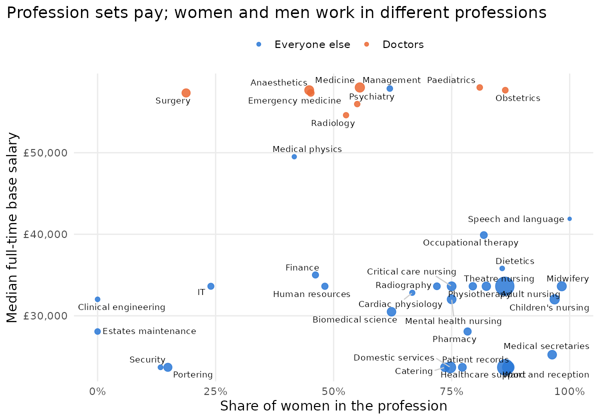
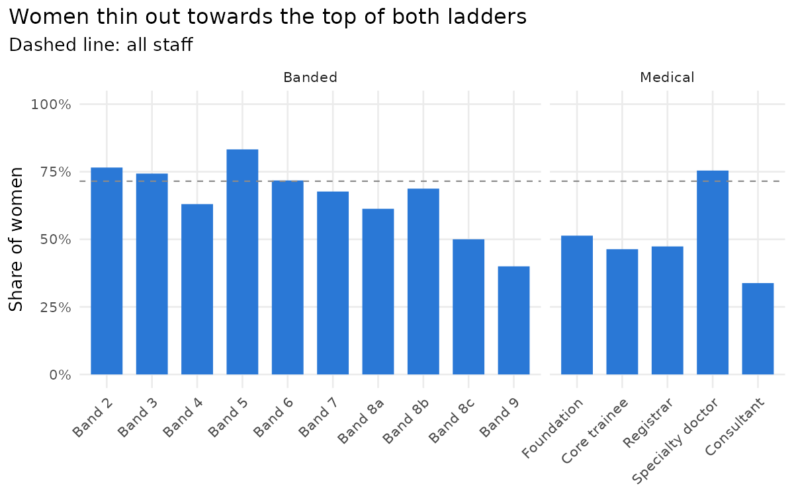
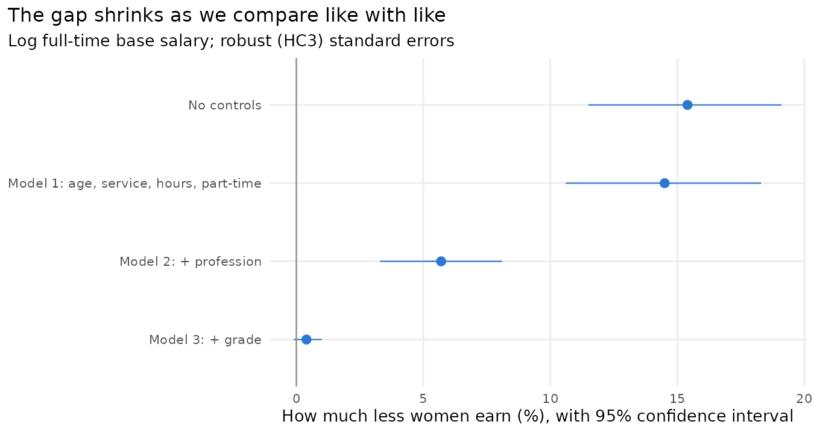
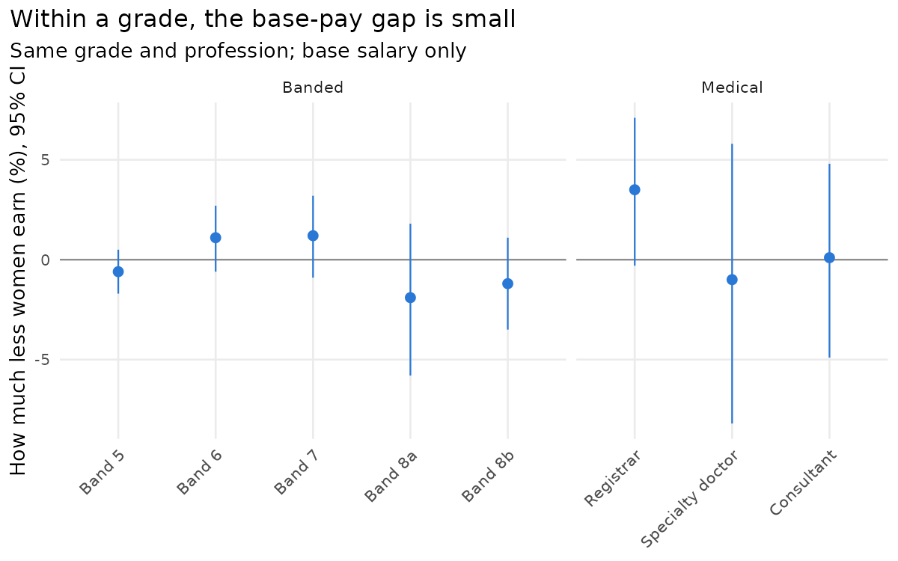
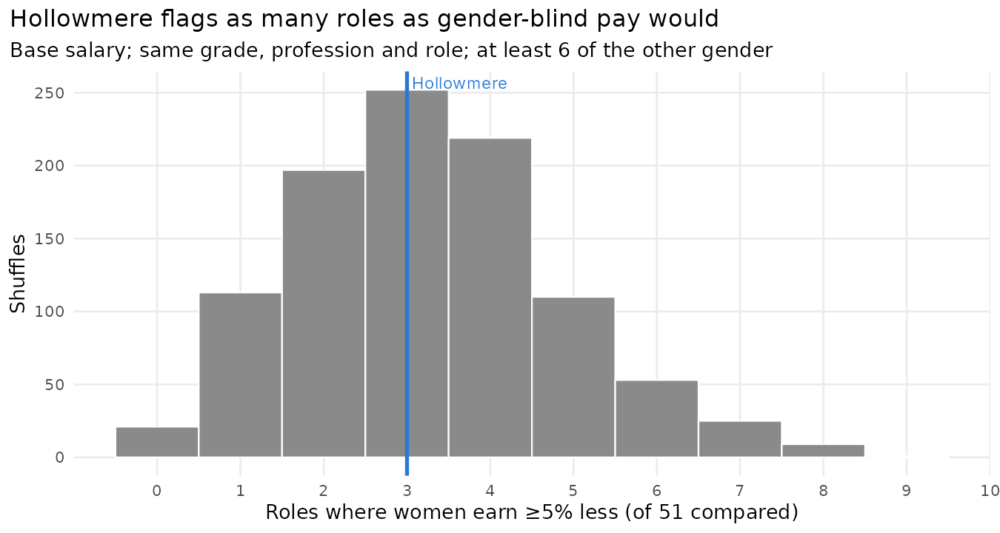
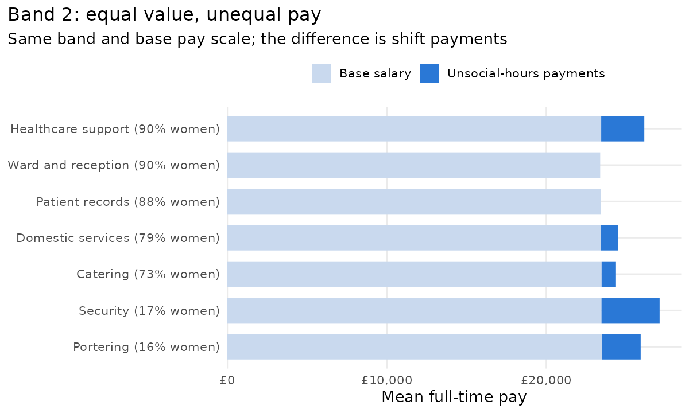
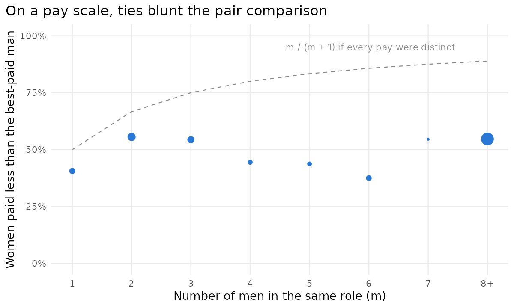

# Introduction

The EU Pay Transparency Directive  requires employers with 100 or more staff to report pay gaps and, where the gap within a category of workers is 5% or more and can't be justified, to carry out a joint pay assessment with workers' representatives. Member states were meant to transpose it by 7 June 2026; Germany missed that deadline. Meanwhile, in October 2025 the German Federal Labour Court (BAG) ruled that a woman can establish a presumption of pay discrimination by pointing to a single male colleague doing equal work who is paid more, without reference to medians or group averages . 

All of these rules turn on statistical questions, and all behave in ways worth understanding before anyone relies on them. To help practitioners estimate the gender pay gap in their organisation I have created a simulated dataset: *Hollowmere General Hospital* is a fictional English hospital with 1,800 staff in 37 professions: doctors in eight specialties, nurses and midwives, physiotherapists and radiographers, biomedical and clinical scientists, pharmacists, porters, cleaners, cooks, security officers, secretaries, and the finance, HR and IT people who run the day to day admin. These fictional people have fictional salaries, and those salaries are unequal. So we can audit the salaries by inspecting the salary list, and see if they discriminate agaist women in any way. The advantage of a fictional hospital is that we already know the truth: we built the gaps in, so we can see which methods find them and which ones mislead. The code that generates the hospital and every figure below is linked at the end.

There is a legal reason to care about doing this well. The EU Pay Transparency Directive  requires employers with 100 or more staff to report pay gaps. Where the gap within a category of workers is 5% or more and can't be justified, the employer has to carry out a joint pay assessment with workers' representatives. Member states were meant to transpose it by 7 June 2026; Germany missed that deadline. Germany's existing Pay Transparency Act already lets employees ask how their pay compares with the median pay of the other gender doing comparable work, but only where there are at least six colleagues of the other gender . And in October 2025 the German Federal Labour Court (BAG) ruled that a woman can establish a presumption of pay discrimination by pointing to a single male colleague doing equal work who is paid more . All three rules turn on statistical questions, and all three behave in ways worth understanding before anyone relies on them.

A note on language. I report every estimate with a **95% confidence interval**, the range of values consistent with the data at the 5% level. I call a result **statistically significant** when p < 0.05: if there were no real difference, a difference at least this large would turn up less than one time in twenty. That also means that across many tests, about one in twenty of the comparisons where nothing is going on will come out significant anyway.

# How Hollowmere is organised

A hospital is a good test case because it has two very different pay systems under one roof, and they're common to most public hospitals, whatever the country.

Everyone except the doctors is on a banded structure. Each role is placed in a band, from Band 2 to Band 9 with Band 8 split into 8a–8d, by job evaluation: a scheme that scores every job on the same factors (knowledge, responsibility, effort, working conditions) regardless of profession. Within a band there are a few pay points; you move up one with each year in the band, and you move up a band by being appointed to a higher-banded post. Doctors are on a separate medical ladder: foundation doctor, core trainee, specialty registrar, then either specialty doctor or consultant, each with its own pay points.

Each employee is described by:

| Field | Examples |
|---|---|
| Staff group | Medical; Nursing & Midwifery; Allied Health; Healthcare Science; Estates & Facilities; Administrative & Clerical |
| Profession | Surgery; Adult nursing; Medical physics; Portering; Domestic services |
| Role | Staff nurse; Ward manager; Clinical scientist; Porter; Consultant |
| Grade | Band 2 … Band 9, or Foundation … Consultant |
| Pay point | Step within the grade |

The banded ladder matters for equal pay law, which covers work of equal value as well as the same work. A Band 2 porter, a Band 2 domestic (cleaner) and a Band 2 catering assistant have been judged by job evaluation to do work of equal value, which makes them legitimate comparators for one another.

Here is what I built in:

* Women and men work in different professions. Midwifery is 99% women and adult nursing 88%; portering is 15% and estates maintenance 5%. Doctors are half women.
* Women are promoted less. At the same age and length of service, women sit lower on their profession's ladder, and so do part-timers. Among doctors, training is time-served, but women are less likely to be appointed consultant and more likely to end up as specialty doctors.
* Women work part-time far more often (33% of women against 7% of men).
Men more often start on a higher pay point, the one place a pay scale leaves room for negotiation.
* Pay outside the scale differs. Shift work brings unsocial-hours payments, and it's concentrated in some professions; doctors do paid on-call, and women do less of it; consultants can receive discretionary excellence awards, and men receive them more often.

I didn't build in any other difference in base pay between women and men in the same job.

# Step zero: The Data is a Mess

Before any statistics, there's the payroll export. Real HR data entry is done by many people over many years, and these people make mistakes. We have to clean our data with a view to what we will do with the data at a later step. We also do not want to bias the downstream models when we clean the data.

Some of what we met in real data:

* grades recorded as `Band 5`, `5` and `B5` in the same column, and Band 8a as `8a`, `8A` or `8 a`;
* decimal commas (`3,5` sick days) next to decimal points;
* ages stored as Excel dates, so a 31-year-old appears as `1900-01-31`;
* "not assessed" in the appraisal column written five different ways, typos included;
* the same department spelled two ways, and recorded under both its old and its new name;
* a pay-scale table that won't join to the staff records, because one file writes `Band 5` and the other `5`.

Three rules saved me repeatedly:

1. Never overwrite a raw column: every cleaned value goes into a new column, so you can always put the raw and clean values side by side and see what a rule did. 
2. Produce a missingness report before any analysis: for every column, how much is missing, which raw values failed to parse, and whether missingness differs by gender. If women's performance ratings are missing more often than men's, a model that drops incomplete rows has a gender bias of its own. 
3. Make the joins loud: when a band lookup fails for everyone, the pipeline should say so, and show the values on both sides, rather than quietly producing a report with no bands in it.

The cleaning is non-destructive pandas; each rule is a small function like this one:

```python
def flag_not_assessed(s):
    """'not assessed / available' in any order, spacing or case, typos included."""
    txt = s.astype("string").str.strip().str.lower()
    return (txt.str.contains(r"\bnot\b", na=False)
            & txt.str.contains(r"asses|avail", na=False)
            & ~txt.str.contains(r"\d", na=False))
```

A single shell script runs the whole chain: raw export → cleaning → missingness report → Parquet → Quarto reports in R → HTML. When someone finds a data entry error, you fix the raw file and rerun one command.

# The raw gap

Hollowmere's women earn 20.2% less than its men on average, comparing full-time-equivalent base salary. The median gap is much smaller, 9.3%, because the mean is pulled up by a few hundred well-paid doctors (half of them men in a workforce that is 72% women).

To come to these raw averages we had to make three decisions.

1. **Full-time equivalent.** Comparing what payroll actually pays, the gap is 27.4%, because women are five times as likely to work part-time. Part-time pay is lower because the hours are lower, not the rate. So all the pay figures here are scaled to full time. Part-time work matters, but through promotion rather than through the monthly payslip.

2. **Which pay.** Including unsocial-hours payments, on-call and awards, the gap is 20.6%. The directive is explicit that pay means every component, and the BAG applies equal pay to each component separately, so each one needs its own analysis. We'll see below that the components are where most of the action is.

3. **Which average.** There are three, and they answer different questions:

* The **mean** adds up everyone's salary and divides by the number of people. Every pound counts the same, so a few very high salaries pull it up a lot. Women's mean is £35,252 and men's £44,203: a gap of 20.2%.
* The **median** is the salary of the person in the middle. It ignores how far the top is from the middle: 9.3%.
* The **geometric mean** is what a regression on log pay compares. It works in percentage terms, so a £10,000 difference counts for much more at £25,000 than at £100,000. Women's geometric mean is £32,986 and men's £38,968: a gap of 15.4%.

At Hollowmere the mean gap is the largest because of the doctors: a few hundred of the best-paid staff, half of them men, in a workforce that is 72% women. A small made-up example shows the mechanism:

| | Salaries | Mean | Geometric mean |
|---|---|---|---|
| Men | £50k, £50k, £200k | £100k | £79k |
| Women | £50k, £50k, £50k | £50k | £50k |
| Gap | | **50%** | **37%** |

Two of the three men earn exactly what the women earn; almost all of the mean gap comes from one very high earner. When the mean gap is much bigger than the geometric one, the gap is concentrated at the top. Report all three, and say which one each figure is.

We also don't just want to report the raw gap, we also want to know what causes that gap so we can do something appropriate to close it.

Two pictures show most of the causes:





Pay is set by profession and grade, and women and men are spread very differently across both. Doctors sit at the top of the pay range; the large nursing and support professions, mostly women, sit below them; but the lowest-paid professions include portering and security, which are mostly men. That's why the correlation between a profession's share of women and its median pay is only −0.1: segregation is about *which* jobs, not simply "women's jobs are paid less".

Up the ladders, women thin out: they're 83% of Band 5 but 60% of Bands 8a–9. On the medical side, women are 48% of doctors in training but only 34% of consultants, and 75% of specialty doctors, the non-training career grade that people move into when they don't become consultants. These are the textbook mechanisms of the gender pay gap, *horizontal* and *vertical* segregation , and an independent review of doctors' pay in England found the same pattern .

# What should we control for?

The standard next move is to run a regression with "controls" and report what's left as the adjusted or unexplained gap. The trouble is that which controls you add changes the question you're answering. A causal diagram makes this explicit:

Show Image

Gender affects pay through several paths: 
1. through which profession people end up in,
2. through their grade, 
3. through part-time work holding back promotion, 
4. and directly, through the dashed arrow: being paid differently for the same job at the same grade. 
5. Age and length of service affect grade and pay but aren't caused by gender, so they're genuine confounders.

Profession and grade are mediators: they sit on the path from gender to pay. Controlling for a mediator doesn't remove bias; it removes part of the effect you're measuring . *If women are promoted less, then comparing women and men at the same grade hides the promotion gap by construction.*

So there isn't one correct adjusted gap; there are several, and each answers a different question:

| Compare women and men… | Question it answers |
|---|---|
| overall | How much less do women take home? |
| in the same profession | How much of the gap is about *which* jobs women do? |
| in the same profession and grade | Are women paid less *for the same job at the same level*? |

The last one is the equal-pay question, the one the law is about. But a small value there doesn't mean the organisation is fair: if women are kept out of the higher grades, the unfairness is in promotion, and the "adjusted gap" has quietly controlled it away.

# Sequential models

Pay is skewed, so we model its logarithm:

$$\log w_i = \alpha + \beta F_i + X_i \gamma + \varepsilon_i$$

where $$F_i = 1$$ for women and $$X_i$$ holds the controls. The coefficient $$\beta$$ is a difference in log points; the gap as a share of men's pay is $$1 - e^{\beta}$$. Adding controls one block at a time shows where the gap goes:

I fix the sequence of models before looking at the results, so that nobody can pick the specification that gives the answer they want:

| Model | Controls | Gap | 95% confidence interval | p | R² |
|---|---|---|---|---|---|
| No controls | – | 15.4% | 11.5% to 19.1% | < 0.001 | 0.04 |
| **Model 1: total effect** | age, length of service, hours, part-time | 14.5% | 10.6% to 18.3% | < 0.001 | 0.08 |
| Model 2 | Model 1 + profession | 5.7% | 3.3% to 8.1% | < 0.001 | 0.77 |
| **Model 3: full model** | Model 2 + grade | 0.4% | −0.1% to 1.0% | 0.09 | 0.99 |



Model 1 is the **total effect**: women and men of the same age and length of service, working the same hours. One caveat: the diagram says part-time work is itself partly a consequence of gender, so strictly Model 1 is the total effect *apart from* the part-time route. Model 3 is the **direct effect**: the same profession and grade as well. In the real analysis Model 3 also held constant management responsibility (the number of direct reports) and which part of the organisation people work in; Hollowmere has no data on the first, and its equivalent of the second, staff group, is already fixed by profession.

The changes from one model to the next split the Model 1 gap of 14.5% into parts that add up exactly:

* **8.8 percentage points from profession** (95% confidence interval 5.5 to 12.2): women and men work in different professions.
* **5.3 percentage points from grade** (2.9 to 7.3): within a profession, women are at lower grades.
* **0.4 percentage points unexplained**: the gap between a woman and a man in the same profession and grade. It isn't statistically significant.

Roughly: three fifths of Hollowmere's gap is which professions women work in, two fifths is that they're promoted less within them, and at the same grade the pay scale pays them the same. That's what I built in. The intervals for the two changes come from 500 bootstrap resamples of the staff, women and men resampled separately, because a difference between two models has no simple standard error.

A warning about order. How much each control seems to explain depends on the order you add them. Add grade before profession, and grade gets more of the credit. That's why the order should be agreed before the analysis, as a statement of the questions you're asking: first *which jobs*, then *which level within the job*. Here the order is natural because the structure is nested. When controls don't have a natural order, the Gelbach decomposition  splits the change between blocks of controls in a way that doesn't depend on the order.

# Robust standard errors, and the gap grade by grade

**Heteroskedasticity.** Ordinary least squares standard errors assume the noise around the model is the same for everyone. Hollowmere shows how badly that can fail: once grade and pay point are known, a banded salary is almost fully determined (the residual standard deviation is 0.005 in log pay), while doctors' pay varies more (0.014). The Breusch–Pagan test  rejects constant variance overwhelmingly (p < 10⁻²⁰⁰). I use HC3 robust standard errors throughout . They cost nothing when the variance is constant and protect you when it isn't, so I use them by default rather than after a test. (HC3 breaks down for groups of one person, such as a role nobody else holds; there I fall back to HC1.)

**Grade by grade.** The overall within-grade gap of 0.2% could hide gaps in particular grades. Estimating it separately for each grade with enough women and men:



Every interval includes zero. The one deliberate difference in base pay, men more often starting on a higher pay point, washes out as people move up the points over the years. That's a feature of short pay scales. The independent review of doctors' pay in England made exactly this recommendation: fewer pay points and more job evaluation .

# Pay outside the scale

Pay gaps in base pay is only one component of the general gender pay gap, and that pay gap is best controlled by a pay scale. Hollowmere's consultants show what happens outside it. On base pay, female consultants earn the same as male consultants (a gap of −0.1%). But 40% of male consultants hold an excellence award against 25% of female consultants, so women receive 35% less in awards, and once awards and on-call are added the consultant gap is 3.6%. This is the pattern the review of English doctors' pay found: gaps in total pay, including clinical excellence awards, allowances and paid additional work, larger than gaps in basic pay .

The lesson for an audit is to analyse each component separately. A result that there is 'no gender pay gap' on base salary says little about awards, bonuses or allowances, which are discretionary or unevenly distributed.

# Length of service: two traps

Does long service pay? It's a natural question to ask, usually as "are long-serving staff falling behind new hires?". The natural model adds length of service to the regression and reads off its coefficient. 

At Hollowmere:

| Compare people… | Change in pay per year of service | 95% confidence interval |
|---|---|---|
| of the same age, gender and hours, in the same profession | +0.81% | +0.65% to +0.97% |
| also in the same role and grade | +0.20% | +0.17% to +0.24% |
| the same, on total pay instead of base salary | +0.21% | +0.14% to +0.27% |
| the same, without holding age constant | +0.21% | +0.17% to +0.24% |

Most of the reward for long service comes from moving up grades: 0.8% a year overall, but only 0.2% a year at the same grade, where it comes from the pay points. Nearly half of the banded staff (48%) are already on the top point of their band, where another year adds nothing. Both rows are correct; they answer different questions. There are two traps we have consider when we make these comparisons however.

**Trap 1: holding grade constant selects people.** Among staff at the same grade, the long-serving ones are disproportionately those who *weren't* promoted: their contemporaries who were promoted have left the comparison. So "long service at the same grade" partly measures who stays at a grade. In an organisation with individually set pay, this can make long service look badly paid at the same level even when nobody's pay is falling behind. The check is to fit the model *without* grade as well. If long service is rewarded overall but not at the same level, the story is about promotion, not about pay drifting. A cross-section can't show promotions directly, though; for that you need people's grade histories.

**Trap 2: age and service together.** Someone's age is their age when they joined plus their years of service. So if a model includes both, the service figure compares two people *of the same age*, one of whom has an extra year of service. The only way that can happen is if they joined a year younger. That isn't the question most people have in mind, which is "what happens to my pay if I stay another year?" Staying another year makes you a year older too. For young staff, the comparison barely exists in the data: no 25-year-old has 15 years' service, so the model has to fill that gap by extrapolating. The simple check is to drop age and see whether the service figure moves. At Hollowmere it doesn't (0.21% a year without age, 0.20% with it), but in other data it can.

There's a cohort side to this too. In a single year's data, long service and "hired in an earlier year" are the same thing. So a weak service effect could mean service isn't rewarded, or that recent hires came in on higher market rates. One snapshot can't tell these apart. You need several years of data, or pay at hiring.

A third check matters outside hospitals. **Compare base salary with total pay.** Components granted at a point in time, such as shares granted at the share price of the day, or awards, can make long-serving staff look better or worse paid for reasons that have nothing to do with how their salaries develop. At Hollowmere base and total pay give the same answer. In a company with share-based pay, they may not.

# Same work: the EU Directive's 5% test

The EU directive splits the workforce into categories of workers doing the same work or work of equal value, and asks whether women's and men's median pay in any category differs by 5% or more. We have to construct the comparison groups to apply this test. So we start with same or comparible work: a category is people with the same grade, profession and role. That gives Hollowmere 162 categories, 111 of which contain at least one woman and one man.

In 12 of those 111, women earn at least 5% less than men on base pay (and in 11, men earn at least 5% less than women). Is 12 a lot?

The categories are small (the median has five or six people), and in small groups averages are noisy. So we asked what the test would show if Hollowmere's pay were gender-blind: shuffle the gender labels within each category, so that pay can't depend on gender by construction, recompute the number of flagged categories, and repeat 1,000 times.



Under gender-blind pay, an average of 10.7 categories are flagged (95% range 6 to 16). Hollowmere's 12 is entirely typical (p = 0.37). The same holds for total pay: 17 flagged against 15.2 expected by chance (p = 0.36). Every flag is what small groups and a few pay points produce on their own. That's the right answer: we didn't build in any same-work base-pay gap, and the test, read against chance, doesn't find one.

This doesn't make the 5% rule wrong: the EU directive treats a 5% difference as a conversation starter, and requires the employer to justify the difference or fix it. But anyone reading a list of flagged categories should know how many to expect from noise. The permutation test is cheap, it needs no modelling assumptions, and gives the right yardstick: not "how many categories are over 5%?" but "how many more than chance?"

```r
library(dplyr)
staff <- staff |> mutate(category = paste(grade, profession, role))
# categories where women's mean pay is at least 5% below men's
n_flagged <- function(d) d |>
  group_by(category) |>
  filter(any(female == 1), any(female == 0)) |>
  summarise(gap = 1 - mean(fte_base[female == 1]) / mean(fte_base[female == 0])) |>
  with(sum(gap >= 0.05))

observed   <- n_flagged(staff)
null_flags <- replicate(1000, staff |>
  group_by(category) |> mutate(female = sample(female)) |> ungroup() |> n_flagged())
mean(null_flags >= observed)        # permutation p-value
```

# Equal value: porters and cleaners

The harder half of the directive is work of equal value. At Hollowmere, job evaluation has put porters, domestics, catering assistants, security officers, healthcare assistants and receptionists in Band 2, on the same base pay scale. They're judged to do work of equal value. But they don't take home the same pay:



Base pay is identical, as it should be. The difference is unsocial-hours payments: porters and security officers, mostly men, work nights and weekends far more often than domestics and catering staff, mostly women. A porter takes home £25,917 on average, a domestic £24,502: domestics earn 5.5% less than porters, for work of equal value.

Whether that's discrimination is a legal question, not a statistical one: paying extra for night work is a legitimate reason, if access to night work isn't itself gendered. But here's the statistical point. If the equal-value category is the whole of Band 2, the gap between all women and all men is only 2.9%, below the threshold. That's because healthcare assistants, 90% of them women, also work nights and earn unsocial-hours payments, which pulls the women's average up. The gap between two specific jobs (5.5%) disappears into the gap between two genders across a band (2.9%). Under the directive, how you form the categories decides what you find, and the employer forms them.

# Three tests for individuals

The rules above look at groups. Equal pay claims are made by individuals, and there are three ways to frame one. Each compares a person with colleagues of the other gender in their category (same grade, profession and role):

* **The Pay Transparency Act test**: is the person paid more than 5% below the median pay of the other gender? Only where there are at least six of them .
* **The EU test**: the same question with any number of colleagues of the other gender. The directive drops the minimum group size: workers can ask for the average pay of their category, broken down by gender, however small it is. Turning that into a 5%-below-the-median test for individuals is my construction, not the directive's wording.
* **The best-paid test**: is the person paid less than the best-paid colleague of the other gender? This is the BAG's pair comparison: one better-paid man doing equal work is enough to establish a presumption of discrimination, and the employer then has to show that the difference has objective, gender-neutral reasons .

I apply all three to women *and* to men, and compare each with the rate you'd expect under gender-blind pay (gender shuffled within categories, 300 times):

| Test | Women: can be compared | Women below | Gender-blind | Men: can be compared | Men below | Gender-blind |
|---|---|---|---|---|---|---|
| Pay Transparency Act (median, at least 6) | 618 | 3.6% | 2.2% | 246 | 1.6% | 4.2% |
| EU (median, at least 1) | 1,143 | 7.8% | 6.9% | 443 | 7.7% | 8.7% |
| Best-paid (at least 1) | 1,143 | 51.4% | 48.6% | 443 | 47.9% | 48.5% |

On the two median tests, women fall below a little more often than gender-blind pay would produce, and men a little less often. That's the one difference I built into base pay: men more often start on a higher pay point. But the differences between women and men aren't statistically significant on any of the three tests (p = 0.20, 1.0 and 0.22).

Another thing we produced was a spreadsheet: for every person, the list of colleagues of the other gender in their category and their pay against the median and the best-paid one, so anyone can check a flag by hand.

**Why the best-paid test flags half the hospital.** How often will a better-paid colleague of the other gender exist? Under gender-blind pay there's a neat answer, *if every salary is different*. Take a role with one woman and $$m$$ men whose pay is *exchangeable*, meaning gender doesn't affect it. Each of the $$m + 1$$ people is equally likely to be the best paid, so the probability that the woman is **not** the best paid is

$$P(\text{a better-paid male comparator exists}) = \frac{m}{m+1}.$$

With one man, it's 50%. With three, it's 75%. With nine, it's 90%. At Hollowmere, the formula predicts that 81% of women would have a better-paid male comparator. In fact only **51%** do, and gender-blind shuffles give 49%. The reason is ties:



On a pay scale with a few pay points, many people earn exactly the same: nearly half of Hollowmere's banded staff (48%) are on the top point of their band. So 44% of women earn exactly what the best-paid man in their role earns. A woman paid the same as every man in her role has no comparator. The $$m/(m+1)$$ formula is right for pay set individually; on a short, transparent scale, most of the exposure disappears.

The best-paid test doesn't detect discrimination: with individually negotiated salaries, most people in mixed teams will have a better-paid comparator of the other gender whether or not anything is wrong. But it does is move the burden of explanation. An employer with individually set pay will face that burden in most of its roles; an employer with a short, transparent pay scale will face it only where people genuinely differ, at the pay points and in the payments outside the scale. And because equal pay law covers work of equal value, in principle the comparator needn't be in the same job: a domestic could point to a porter.

# What organisations should report

* **Report the raw gap and the adjusted gaps, and say which question each answers.** At Hollowmere, "women earn 20% less" and "women at the same grade are paid the same" are both true. The first is about which professions women work in and who gets promoted. The second is about equal pay for equal work.
* **Say which average.** Mean, median and geometric mean give 20%, 9% and 15% at Hollowmere. Each is right; none is *the* gap.
* **Agree the models before the analysis.** Which controls, in which order. The split of the gap between them depends on the order, so fix it as a statement of the questions you're asking, not after seeing the results.
* **Don't let controls launder the problem.** Grade is a mediator. A zero gap at the same grade with a large promotion gap is not a clean bill of health: look at promotion and appointment directly.
* **Report confidence intervals, and read flags against gender-blind pay.** With small categories, many 5% flags are noise. A permutation test tells you how many to expect.
* **Check length of service three ways.** With and without grade held constant, with and without age, and on base salary as well as total pay. A negative effect at the same level can be selection, not pay falling behind.
* **Analyse every pay component separately.** Awards, allowances and bonuses often carry larger gaps than base salary, and the law treats them separately.
* **Look across jobs, not just within them.** Equal-value comparisons, like porters and cleaners, find gaps that same-job comparisons can't, and how the categories are drawn decides whether they show up.
* **Structure protects.** Short pay scales with few points, job evaluation and transparent rules for extra payments leave little room for gaps in the same job, and make the best-paid test much less threatening for an employer who can explain its pay.
* **Spend the time on the data.** Most of my errors, and most of the interesting findings, came from cleaning, joins and missing values, not from the models.

# Code

The R script that builds Hollowmere and produces every figure and number in this post, hollowmere.R, is here. It also writes the synthetic staff file, so you can try your own analyses on it.

References

